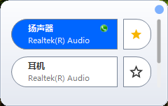

# Audio Switcher

一个放在托盘里的小工具，帮你一键切换默认音箱 / 耳机。

## 效果预览
<table>
  <td></td>
</table>

## 它解决什么问题

电脑同时接了音箱和耳机，每次换着用都要走一遍：开始菜单 → 设置 → 系统 → 声音 → 选输出设备。四五下点击，挺烦。

装上这个之后，托盘区会多一个小音响图标：

- **鼠标放上去**，就知道现在用的是哪台设备；
- **点一下图标**，弹出一个小卡片，点哪台就切到哪台；
- **常用的几台点个星**，之后双击图标就能在它们之间来回切；
- **还能设一个全局热键**，玩游戏、看视频时不用切窗口就能换设备；
- 打开「双切换模式」的话，切歌用的设备会顺手把语音通话的设备也一起换掉。

## 怎么用

| 你做什么 | 它会做什么 |
| --- | --- |
| 鼠标移到托盘图标上 | 显示当前默认设备的名称 |
| 单击托盘图标 | 弹出小卡片，里面是所有可用的播放设备 |
| 在卡片里点一台设备 | 立刻切过去，高亮也跟着走 |
| 点设备右边的星星 | 收藏 / 取消收藏 |
| 双击托盘图标 | 在你收藏的设备之间轮流切换 |
| 右键托盘图标 | 弹出「退出」 |
| 点卡片右上角的齿轮 | 打开设置：开机自启、双切换模式、换设备的热键 |
| 按 Esc | 关掉卡片 |

## 怎么安装

**不用安装。** 下载 `out\AudioSwitcher.exe`，双击运行，托盘区就会多一个图标。

想让它开机自动启动，打开卡片 → 点齿轮 → 勾上「开机自启动」即可，不需要管理员权限。

**系统要求**：Windows Vista 及以上；.NET Framework 4.5.2 及以上（Windows 10 / 11 都自带，不用另装）。

## 你的设置存在哪

`%LocalAppData%\AudioSwitcher\AudioSwitcher.json`

把它删掉，下次启动就是全新的默认设置。

## 常见问题

**问：弹窗说「Audio Switcher 已在运行」。** <br>
它已经在托盘里跑着了，从托盘区找那个小音响图标就行，不用再开一个。

**问：设置改过，重启后又变回去了。** <br>
去看看 `%LocalAppData%\AudioSwitcher\` 这个文件夹能不能写——文件夹设成只读、磁盘写满、或者被安全软件锁住，都会导致设置存不下来。

**问：热键按了没反应。** <br>
多半是这个组合键被别的软件占了（卡片里会提示你）。换一个组合键，或者先找出是谁占了它。

**问：我把 exe 解压在压缩包里直接运行，勾了自启却没生效。** <br>
这是故意设计的：程序发现自己在临时目录里跑，就不会写开机自启。因为临时目录随时会被清理，写进去只会让你下次开机看到一个「找不到程序」的报错。把 exe 挪到固定的文件夹（比如 `D:\Tools\`）再设置就好。

**问：怎么卸载？** <br>
先去设置里取消「开机自启动」，然后删掉 exe，最后删掉 `%LocalAppData%\AudioSwitcher\` 文件夹，就干净了。

## 它不做什么

- **不联网**。它连不上任何服务器，也不会收集你的信息、上传你的设备名，所有设置只存在你自己电脑上。
- **不切换录音设备**。它只管「播放」（音箱、耳机、显示器扬声器），麦克风那一路不碰。
- **只支持一个热键**。够用了：一个热键在收藏的设备之间轮换，就把所有场景覆盖了。

## 想自己编译

不用装 Visual Studio。在仓库根目录双击 `build.cmd`，或者命令行执行：

```bat
build.cmd
```

看到 `[build] OK -> out\AudioSwitcher.exe` 就成了。

前提是机器上有 .NET Framework 4.x（Windows 10 / 11 自带）或 .NET SDK，脚本会自己挑一个能用的。更细的说明、以及编译时可能遇到的坑，都写在 [编译说明.md](编译说明.md) 里。

## 关于这个项目

- 它是个纯托盘程序，窗体本身永远是隐藏的，界面都画在那张小卡片上。
- 整份代码只有 31 个 C# 文件，没有引用任何第三方库。
- 注释写得比较密，风格说明在 [注释规范.md](注释规范.md)。

# 版权说明

本程序为基于 AudioSwitcher_v1 的衍生修改版本，遵循 **Microsoft Public License (MS‑PL)** 开源许可协议。

## 原始项目信息
原始项目：AudioSwitcher_v1<br>
原作者：xenolightning (Sean Chapman)<br>
原始仓库地址：https://github.com/xenolightning/AudioSwitcher_v1<br>
原始许可证：Microsoft Public License (MS‑PL)

## 本衍生版本信息
修改维护者：laomor<br>
衍生版本仓库：https://github.com/laomor/Audio‑Switcher<br>
本版本在原版基础上进行自定义开发、功能调整与问题修复。
> 重要：分发本软件（源码或编译后的 exe）时，必须保留完整 MS‑PL 许可证文本，保留原始版权与归属声明，不得移除原始项目来源信息。

## MS‑PL 协议声明
完整 Microsoft Public License 协议文本见 LICENSE 文件。<br>
THE SOFTWARE IS LICENSED "AS‑IS." YOU BEAR THE RISK OF USING IT.
